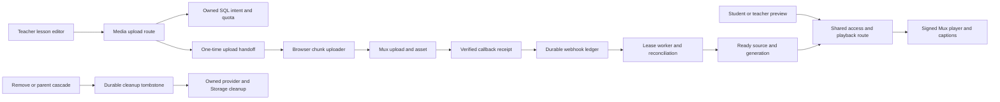

# Mux video hosting: proposed file and integration map

This is the file-level implementation blueprint for the [master design](MUX_VIDEO_HOSTING_PLAN.md), [TDD contracts](MUX_VIDEO_TDD_PLAN.md), [runbook](MUX_VIDEO_OPS_RUNBOOK.md), [references](MUX_VIDEO_REFERENCES.md) and [finding ledger](MUX_VIDEO_REVIEW_FINDINGS.md). It maps the whole approved hosting vision before coding: saved lesson -> owned direct upload -> durable callback -> ready source -> signed player/captions -> recovery/removal -> operator/accounting, followed by supported wider-release history/client contracts.

**Inventory baseline:** application `d43012004ac45d49c5926b306bd95f786c885285`, planning `9784ef810b3c24b137a1ba6021ce9a56cce37c6a`. Every existing path below was checked against this checkout. `Create` paths are proposed, not implemented. `Modify` names an existing seam; `Verify` requires evidence and does not presume a code change; `Regenerate` is a generated artifact, not hand-authored logic. WS5/WS6 are later packages, not pilot prerequisites unless explicitly marked initial guard. Internal `[locale]` directories do not alter the agreed public English URLs.

This map does not authorize application coding, dependency installation, hosted SQL, deployment or enablement. Do not create empty modules/migrations to make the tree look complete. Implement vertical slices in [package order](MUX_VIDEO_TDD_PLAN.md#package-order-and-deliverables), starting with failing acceptance tests. A coherent implementation may consolidate a proposed module, but update this map and its consumers/tests before changing a boundary; do not silently add a parallel architecture.

## What the finished experience looks like

1. A teacher saves a real lesson draft, chooses upload or external video, sees safe file guidance/progress and can recover after losing the tab's File. A provider upload never precedes an owned lesson/intent.
2. The browser uploads bytes directly to Mux. Application routes own authorization, quota reservations and the one-time handoff; they do not proxy large video bytes or persist the upload URL.
3. Signed callbacks become immutable durable receipts; a worker verifies owned provider metadata and moves the media/source atomically. Processing never depends on the callback staying open.
4. The same access gate issues current-source playback tokens and renewals to entitled active members. The player retains checkpoint behavior, pause/playhead and caption controls. Existing external video and private audio/documents continue separately.
5. Teacher removal, parent deletion, late ingest, uncertain creates and caption retries retain cleanup/accounting intent. Operators have a bounded audited report/takedown surface and an observable scheduler.
6. Wider release adds plan tiers, supported source history/replacement and client contracts. Optional AI/workflows/search remain a separate future design, not files to scaffold now.

## Boundary and ownership rules

- App routes/components do not import the provider SDK directly. `lib/media/mux.ts` is server-only; pure contracts/core types and resume helpers are the explicit browser-safe exceptions. No barrel exporting secrets into a client bundle.
- SQL owns ownership constraints, state/generation/cap locks and lease fencing. Application services own verified access and external calls; no provider request inside a transaction holding school/lesson row locks.
- `lib/storage/lesson-media.ts` already serves private audio/documents. The new `lib/media/` namespace means primary lesson **video hosting**, not replacement of those audited upload paths.
- Existing authenticated teacher preview and student pages provide the real-app harness. No public debug route, request-controlled TTL or separate demo authorization path.
- The new safe GET source summary shares the existing source route file and fresh access gate, gives app/MCP/native callers LMS identity/state/capabilities only, and does not mint a grant. It avoids direct reads of server-owned provider/settings tables.
- Before pilot, unsupported legacy/MCP/core/native readers must resolve or explicitly refuse hosted sources; full later support is WS6. Native application source is not present in this checkout: its actual repository/path inventory is a required WS6 deliverable, not guessed filenames in this map.
- References guide narrow behavior. SayThanks is the primary internal provider/provenance reference; Whop supplies course/editor/player patterns; Uvacha and Simply Learn inform handoff/UI; the Sonny external example informs fallback. Licensing/auth limitations remain those in the appendix. No restricted/unclear-license code copying.

## Reference keys used below

Each key names exact source files/symbols, not a recommendation to transplant a product. See the [license table and full pinned appendix](MUX_VIDEO_REFERENCES.md#source-verification-and-reuse-rules). `Local` means LMS-specific design/current seams and the linked T-ID, with no adequate upstream implementation to copy.

| Key | Exact pinned source and intended guidance |
| --- | --- |
| S-client | [SayThanks mux-client.ts][s-client]: lazy SDK/config, PEM normalization, bounded provider operations and signing. |
| S-upload | [SayThanks collection-form-media.ts][s-upload]: reserve first, server-derived CORS, direct upload handoff. |
| S-provenance | [SayThanks mux-upload-provenance.ts][s-provenance]: opaque ownership correlation, reconcile and foreign/orphan handling. |
| S-webhook | [SayThanks webhook route][s-webhook]: raw signature/asset lifecycle pattern; adapt to this plan's durable unleased queue. |
| S-playback | [SayThanks playback route][s-playback]: verify access before signed capabilities and no-store responses. |
| S-player | [SayThanks video-player.tsx][s-player]: lazy player, token/poster/error and external fallback UX. |
| S-schema | [SayThanks provider migration][s-schema]: provider constraints to compare; do not copy its full application schema. |
| U-session / U-flow / U-player | [Uvacha upload-session][u-session], [metadata helper][u-meta], [finalize][u-finalize], [upload test][u-test], [watch player][u-player]: compact handoff/progress/recovery test ideas; reject public playback/client-finalize authority. |
| W-env / W-schema | [Whop mux.ts][w-mux], [env.ts][w-env], [Prisma schema][w-schema]: SDK/env and course ownership shape, adapted to LMS SQL/RLS rather than Prisma. |
| W-editor / W-player / W-learn | [Whop course editor][w-editor], [player][w-player], [learning page][w-learn]: lesson product layout, progress/ready states and player placement; no automatic completion or old-asset-first deletion. |
| W-webhook / W-playback / W-seed | [Whop webhook][w-webhook], [playback route][w-playback], [seed uploader][w-seed]: lifecycle/signing and disposable smoke structure; enrollment-only and provider-ID access are not LMS authorization. |
| E-player / L-upload | [Sonny external VideoPlayer][e-player], [Simply Learn MuxUpload][l-upload]: external fallback and file/progress UI; no Xano/Clerk/Sanity substitution. |
| SDK | [Published @mux/ts 15.6.1 sources and live boundaries](MUX_VIDEO_REFERENCES.md#documented-provider-contracts-and-live-boundaries): optional URLs, cancellation, track names/passthrough/events, JWTs and unique webhook addresses. |

## Inventory totals

The following **228 file entries** cover pilot and explicitly staged wider release, including tests/fixtures and existing integration seams. Counts describe this proposed layout, not completed work or a requirement for empty scaffolding.

| Action | Entries |
| --- | --- |
| Create | 134 |
| Modify | 61 |
| Verify | 31 |
| Regenerate | 2 |

## Shared contracts and application services

`lib/media/` is the application-owned feature boundary. Every module is server-only except the explicitly client-safe contracts/resume modules. Production SDK imports are confined to mux.ts; contract test fixtures may inspect published SDK types without exporting them to clients. No generic repository framework or parallel authentication system is introduced.

| Action | Proposed repository path | Package | Responsibility / expected seam | Reference / acceptance |
| --- | --- | --- | --- | --- |
| Create | `packages/core/src/types/media.ts` | WS1 | Client-safe source/state/status/playback/error DTO types, with no provider asset/upload IDs or SDK types. Shared by app and MCP; later native clients consume this contract. | Local; T03/T13/T27 |
| Create | `lib/media/contracts.ts` | WS1/WS2b | Request schemas and allowlisted response mappers: start/restart/source/caption/takedown inputs and safe DTOs. Browser-safe; imports core types, never service clients or secrets. | Local; T04/T12/T13 |
| Create | `lib/media/policy.ts` | WS2a/WS2b/WS3 | Typed canonical body, quota, retry, clock, duration and TTL policy from the master. Exposes calculation functions; server supplies safe browser guidance, not a second frontend limits table. | SDK; T06/T09/T12 |
| Create | `lib/media/env.ts` | WS2a/WS3 | Validate canonical flags, lazy operation credentials, exact environment and paired staging-fixture policy. Reject invalid fixture/production combinations without requiring Mux keys for disabled external-only builds. | S-client/W-env; T06/T26 |
| Create | `lib/media/mux.ts` | WS2a | Lazy pinned SDK adapter: create/retrieve/list/cancel uploads; retrieve/delete assets; create/list/delete tracks; verify signatures and sign playback. Explicit timeouts, no automatic create retries, normalized PEM and sanitized errors. Has no authorization discretion. | S-client/W-env/SDK; T01/T08/T21/T22 |
| Create | `lib/media/auth.ts` | WS2b/WS4 | Resolve explicit cookie/Bearer mode, reject mixed credentials and verify user identity. Return trusted actor/tenant context; validate mutation Origin with origins.ts. Operator checks never trust inbound x-user-id. | Local; T03/T04/T11 |
| Create | `lib/media/access.ts` | WS2b/WS3 | WS2b supplies fresh active author/admin write access; WS3 extends the same service to entitled student reads. Fresh active membership plus scoped lesson/course lookup, then author/admin/entitlement+cutoff. Shared playback/status/source read gate; DB failure denies. Preserve the separate public-resource-preview contract. | S-playback/W-playback/Local; T13/T17 |
| Create | `lib/media/origins.ts` | WS2b | Pure school/platform origin construction from verified tenant/config; no request headers or invented custom-domain allowlist. | S-upload/Local; T14/T23 |
| Create | `lib/media/http.ts` | WS2b | Bounded streamed JSON/UTF-8 body reader, strict Content-Type, no-store JSON responses and stable sanitized error/status mapping. Shared thin route glue; no provider calls. | Local; T04/T10/T13/T20 |
| Create | `lib/media/rate-limit.ts` | WS2b/WS3 | Call the atomic Postgres user/school limiter and map exhaustion/outage correctly. No per-process fallback or per-view session ledger. | Local; T09/T20 |
| Create | `lib/media/source.ts` | WS2b/WS3 | Resolve external/hosted/unavailable source, safe capability summary and generation; wrap SQL compare-and-swap selection/removal guards. All renderers/legacy extractors consult this before retained video_url. | S-playback/W-schema/Local; T05/T07/T15/T28 |
| Create | `lib/media/uploads.ts` | WS2b | Start/status/restart orchestration over durable reserve/bind RPCs. Enforce request fingerprint, saved-lesson ownership, caps and remove-first rule; preserve unknown create outcomes and File/URL recovery semantics. | S-upload/S-provenance/U-session; T07/T12/T21 |
| Create | `lib/media/webhook-receipts.ts` | WS2a | Verify bounded raw callback, signature/time/environment; redact/project immutable receipt and enqueue unleased due work. Duplicate/current-next callbacks share dedupe. Acknowledge without SDK metadata calls. | S-webhook/W-webhook/SDK; T01/T02/T19/T22 |
| Create | `lib/media/webhook-worker.ts` | WS2a | Claim due receipt leases, validate owned provenance with authoritative metadata and dispatch idempotent SQL transitions; fence completion/failure and dead letters. No payment dispatch. | S-webhook/S-provenance/Local; T01/T02/T22 |
| Create | `lib/media/reconcile.ts` | WS2b | Bounded repair of uncertain uploads/assets/captions and expired leases. Exact nonce/environment correlation; scan exhaustion stays unknown. Late assets for deleted lessons go to retained cleanup identity, never new owner rows. | S-provenance/U-flow; T01/T21/T29 |
| Create | `lib/media/cleanup.ts` | WS2b/WS4 | Lease durable owned outbox work, honor independent destructive flag, delete/not-found assets/tracks/Storage objects, retain failed inventory and release once. Handle captured waiting-upload/intent identity after parent deletion. | S-provenance/Local; T10/T28/T29 |
| Create | `lib/media/vtt.ts` | WS4 | Pure WebVTT validation/canonicalization: fatal UTF-8, BOM/NUL/surrogates, cue/settings/size/duration limits, supported overlap and NOTE/STYLE/REGION policy. No HTML rendering. | SDK/Local; T10/T15 |
| Create | `lib/media/captions.ts` | WS4 | Authorize and reserve caption/ingest attempts, store private VTT, sign source transiently, create uniquely named/correlated tracks, reconcile uncertain calls, swap ready association and queue all old-track/source cleanup. | SDK/S-provenance; T10/T15/T22 |
| Create | `lib/media/playback.ts` | WS3 | Reauthorize current selection, readiness/flags and throttle; mint correct audience/expiry tokens through mux.ts. Apply server fixture TTL only for approved staging context; return renewal schedule and safe caption languages. | S-playback/W-player/SDK; T06/T13/T17 |
| Create | `lib/media/operator.ts` | WS4 | Verified actor to fresh super_admins membership; bounded inventory/cost/stuck report, school disable and owned takedown with durable audit. No impersonation or automatic production key deletion. | Local; T11/T16 |
| Create | `lib/media/maintenance.ts` | WS2b | Strict dedicated-secret authentication, constant-time comparison, common batch/time budget and safe tick summary for reconcile/cleanup. Emit observable success/failure, including empty success. | Local; T20/T24 |
| Create | `lib/media/resume.ts` | WS3 | Client-safe user+LMS-media local resume storage and prefix cleanup. No URL/token/provider ID; no cross-version/device promise. Pure storage operations are separately testable. | S-player/U-player; T06/T16 |
| Create | `lib/media/plan-limits.ts` | WS5 | Media-specific fail-closed eligible-plan resolver and attribution/usage composition. Preserve generic non-media missing=unlimited; finite pilot settings already work. | Local; T18 |
| Create | `lib/media/history.ts` | WS6 | Supported source/snapshot/restore and replacement application orchestration over reviewed SQL; generation increases, historical deleted media stays unavailable and provider ownership is never cloned by copying IDs. | W-schema/Local; T05/T18/T28 |

## HTTP route files

Every route is a thin adapter to the services above: await Next route params, validate identity/body, call one operation, return an allowlisted DTO. Existing master paths are preserved. The GET source-summary method below fills the safe app/MCP/native read boundary; it never returns a playback grant.

| Action | Proposed repository path | Package | Responsibility / expected seam | Reference / acceptance |
| --- | --- | --- | --- | --- |
| Create | `app/api/lessons/[lessonId]/media/uploads/route.ts` | WS2b | POST new direct-upload intent/handoff; map created/already_created/uncertain outcomes without URL recovery on duplicates. | S-upload/U-session; T04/T07/T12/T21 |
| Create | `app/api/lessons/[lessonId]/media/[mediaId]/route.ts` | WS2b | GET teacher safe status and DELETE owned removal. No raw provider row serialization; removal remains available when hosting is off. | S-provenance/Local; T07/T13/T29 |
| Create | `app/api/lessons/[lessonId]/media/[mediaId]/restart/route.ts` | WS2b | POST explicit new-key restart only after old waiting cancellation/absence is confirmed; ingest-winning race returns processing. | S-provenance/SDK; T07/T12/T21 |
| Create | `app/api/lessons/[lessonId]/media/source/route.ts` | WS2b/WS3 | PUT generation-checked source choice; GET authenticated safe current-source/capability summary for clients that cannot read server-owned tables. No raw video_url fallback in hosted mode, provider IDs or grant tokens. | S-playback/Local; T03/T07/T13/T17 |
| Create | `app/api/lessons/[lessonId]/media/[mediaId]/captions/route.ts` | WS4 | POST bounded JSON VTT declaration, language/label and idempotency; delegate private storage/track work to captions service. | SDK/Local; T04/T10/T15 |
| Create | `app/api/lessons/[lessonId]/media/[mediaId]/captions/[captionId]/route.ts` | WS4 | DELETE scoped caption association and queue idempotent track/Storage cleanup. | SDK/Local; T10/T29 |
| Create | `app/api/lessons/[lessonId]/media/playback/route.ts` | WS3 | GET initial/renewed stateless signed capability after the same fresh access/current-source gate. | S-playback/W-playback; T03/T06/T13/T17 |
| Create | `app/api/mux/webhook/route.ts` | WS2a | POST verified raw receipt to shared ingest; work while hosting flags are off, without user session or provider API calls before ack. | S-webhook/W-webhook; T01/T14/T22 |
| Create | `app/api/mux/webhook/next/route.ts` | WS2a | POST rotation alias using the same receipt/dedupe implementation and verified current/next secret mapping. | SDK; T22 |
| Create | `app/api/cron/mux-reconcile/route.ts` | WS2b | GET authenticated bounded receipt/intents/captions repair and safe tick result; dedicated maintenance secret. | Local; T20/T24 |
| Create | `app/api/cron/mux-cleanup/route.ts` | WS2b | GET authenticated bounded outbox cleanup with destructive flag independently enforced. | Local; T20/T24/T29 |
| Create | `app/api/platform/media/route.ts` | WS4 | GET independently authenticated operator inventory/cost/stuck summary; privileged provider identity may appear here, capabilities never do. | Local; T11/T16 |
| Create | `app/api/platform/media/takedown/route.ts` | WS4 | POST independently verified operator action, exact platform Origin, reason/target check and durable audit/outbox. | Local; T11/T16 |

## SQL, shared variants and generated contracts

These are proposed ordered names, to be checked against main before implementation. Do not create placeholder migrations or put global Storage SQL through an lms namespace replacement. SQL owns transactional integrity; TypeScript orchestrates external calls outside row-lock transactions.

| Action | Proposed repository path | Package | Responsibility / expected seam | Reference / acceptance |
| --- | --- | --- | --- | --- |
| Create | `supabase/migrations/20261023120000_lesson_media_core.sql` | WS1 | Tables, provider-global/composite uniqueness, source generation/status triggers, server-only grants/RLS, snapshot markers and initial restore/clone guards. Outbox retains pending upload/intent correlation as well as known asset/track/path identities before cascades. | W-schema/S-schema/Local; T05/T27/T28/T29/T30 |
| Create | `supabase/migrations/20261023121000_mux_webhook_queue.sql` | WS2a | Immutable unleased Mux enqueue, due-state/retry/dead-letter metadata and fenced lease functions on existing ledger, preserving payment RPC semantics. | S-webhook/Local; T01/T02/T22 |
| Create | `supabase/migrations/20261023121500_lesson_media_operations.sql` | WS2b | Atomic reservation/bind/restart/select/remove/capacity/rate/audit functions; fixed lock order, UTC counters and once-only releases. Caption-specific ingest RPCs belong to the separately mapped WS4 application migration. | Local; T07/T09/T12/T20/T28 |
| Create | `supabase/migrations/20261023121800_lesson_caption_operations.sql` | WS4 | LMS-qualified caption reservation, provider ingest-attempt correlation, ready-association swap and cleanup RPCs; included in the application lms variant, never the global Storage file. | SDK/Local; T10/T15/T29 |
| Create | `supabase/migrations/20261023122000_lms_caption_storage.sql` | WS4 | Global private caption bucket and restrictive browser policy only. LMS caption tables/functions belong to core/application migrations and their checked namespace variant. | SDK/Local; T10/T15/T29 |
| Create | `supabase/migrations/20261023123000_media_plan_limits.sql` | WS5 | Media plan feature/limit backfills and media-specific resolver; no generic billing semantics change or automatic asset deletion. | Local; T18 |
| Create | `supabase/migrations/20261023124000_media_history.sql` | WS6 | Later supported history/restore/replacement contracts and guard evolution after their tests exist. No automatic provider-copy subsystem. | W-schema/Local; T05/T18/T28 |
| Create | `supabase/shared-db/lms-lesson-media.sql` | WS1b, maintained per package | Checked ordered lms variant of application feature SQL; no imported shared baseline and no unrelated SayThanks/auth changes. | Local; T27/T30 |
| Create | `supabase/shared-db/lms-caption-storage.sql` | WS4/WS1b | Global Storage counterpart matching canonical caption bucket/policy statements. Any accompanying LMS-specific caption functions belong to the checked lms application variant, not an unsafe rewrite of storage.*. | Local; T10/T27 |
| Create | `supabase/shared-db/lesson-media-manifest.json` | WS1b | Explicit ordered source-file/section/checksum/prerequisite inventory for the two variants. Small checked manifest, not a SQL generation framework. | Local; T27 |
| Regenerate | `lib/database.types.ts` | WS1 and later SQL packages | Regenerate public feature database types using the actual local schema; preserve full compiler inputs. Shared catalog parity checks prove namespace equivalence; no invented hand-written generated table stubs. | Local; T27 |

## Teacher, student and operator presentation

The existing lesson editor and authenticated preview/student pages remain the product shell. No separate video-library app, new public harness URL or upload button on every generic MDX/media field is required.

| Action | Proposed repository path | Package | Responsibility / expected seam | Reference / acceptance |
| --- | --- | --- | --- | --- |
| Create | `components/teacher/lesson-editor/video-source-field.tsx` | WS4 | Upload/external source choice and generation-aware selection; existing external URL editing stays available. Require a saved draft/lesson ID before starting any provider upload. | W-editor/E-player; T07/T15 |
| Create | `components/teacher/lesson-editor/hosted-video-upload.tsx` | WS4 | Accessible file chooser/drop/progress/pause/retry/reselect/restart UI; safe guidance and cap/error messages. No secrets or persisted handoff URL. | W-editor/L-upload/U-flow; T07/T12/T21 |
| Create | `components/teacher/lesson-editor/use-hosted-video-upload.ts` | WS4 | In-tab File+handoff lifecycle, chunk uploader integration, abort/polling and lost-File recovery. Reload restores server status, never a File object or assumed retrieve URL. | U-flow/S-upload; T21 |
| Create | `components/teacher/lesson-editor/hosted-video-status.tsx` | WS4 | Safe uploading/preparing/ready/error/deleting state and retry/remove capability display, without provider identity or invented time-to-ready guarantees. | W-editor/U-flow; T07/T15 |
| Create | `components/teacher/lesson-editor/lesson-captions-manager.tsx` | WS4 | Per-language/label VTT add/update/remove and separate caption status, safe errors and publish warnings/required-policy feedback. | SDK/Local; T10/T15 |
| Create | `components/lesson/hosted-video-player.tsx` | WS3/WS4 | Dynamic Mux Player with signed tokens/poster/CC, accessible state UI and existing checkpoint handle/event interface. No auto-complete on ended or unauthorized external fallback. | S-player/W-player/U-player; T06/T15/T17 |
| Create | `components/lesson/use-hosted-playback.ts` | WS3 | Deduped authenticated grant/renewal, actual expiry scheduling, background return, generation changes, access-ended and bounded temporary retry. No provider API fetch in the browser. | S-player/W-player; T06/T13 |
| Create | `components/lesson/use-video-resume.ts` | WS3 | Connect player events to user+media resume helpers; preserve pause/playhead on same-media renewal and separate a new media version. | U-player/Local; T06/T16 |
| Create | `components/lesson/media-session-boundary.tsx` | WS3/WS4 | Global auth lifecycle listener, mounted in locale layout, clears resume prefix on logout/account switch and initial identity mismatch, even when the player is unmounted. No broad auth behavior changes. | Local; T16 |
| Create | `app/[locale]/platform/media/page.tsx` | WS4 | Protected operator report page using existing platform layout/page-header patterns; bounded inventory, costs and stuck items. API verifies identity independently of page props. | Local; T11/T16 |
| Create | `app/[locale]/platform/media/loading.tsx` | WS4 | Existing-platform-style loading skeleton for the new report page. | Local; T11 |
| Create | `app/[locale]/platform/media/error.tsx` | WS4 | Sanitized retryable operator-page error boundary with no secret/raw provider payload. | Local; T11/T19 |
| Create | `components/platform/media/media-inventory.tsx` | WS4 | Bounded table/filter/status report plus safe usage diagnostics; no requirement for a new analytics suite. | Local; T11/T16 |
| Create | `components/platform/media/media-takedown-dialog.tsx` | WS4 | Explicit owned target/reason/impact confirmation and server-audited request; no automatic key-delete control. | Local; T11/T16 |

## Provisioning, verification and live-run source files

These are runnable source tools once implemented. They must fail closed on an unidentified/nonapproved target. Real manifests, keys, generated media and catalog exports are runtime artifacts, not source files or committed credentials.

| Action | Proposed repository path | Package | Responsibility / expected seam | Reference / acceptance |
| --- | --- | --- | --- | --- |
| Create | `scripts/ci/run-db-tests.mjs` | WS0 | Run discovered actual local pgTAP suite, preserve exit/report, reject empty/invalid/skipped required plans and upload results through CI. No shared reset. | Local; T25 |
| Create | `scripts/ci/check-media-tests.mjs` | WS2a–WS4 | Validate required media discovery/report against active package manifest, per project/shard, failing skips/fixmes/retries without requiring every file on every shard. | Local; T25/T26 |
| Create | `scripts/media/check-shared-sql.ts` | WS1b | Validate ordered namespace/global variants and checksums, reject unsafe helper/schema/string substitutions; compare disposable normalized catalogs. Only its explicitly disposable fixture mode may write. | Local; T27/T30 |
| Create | `scripts/media/verify-target.ts` | WS1b | Read-only app/project/catalog/owner/type/grant/prerequisite verifier with a redacted target receipt. No migrate/reset/repair mode. | Local; T03/T27 |
| Create | `scripts/media/generate-fixture.ts` | Ops | Generate owned synthetic video/audio/VTT for real smoke outside Git; preflight its test-runner media generator and fail if unavailable. No third-party course content or app ffmpeg dependency. | W-seed/Local; T08 |
| Create | `scripts/media/live-smoke.ts` | Ops | Approved staging identity checks, fixture role/data manifest, real uploads/callbacks/races and authenticated app operations; record outcomes separately, never pass skipped controls. | W-seed/S-provenance; T01/T03/T08/T21 |
| Create | `scripts/media/live-cleanup.ts` | Ops | Cleanup-always handler for recorded fixture identities, using scoped app cleanup and independent deletion switch; report retained/unknown objects and never scan-delete an entire account. | S-provenance/Local; T22/T29 |
| Create | `scripts/media/sweep-fixtures.ts` | Ops | Independent bounded orphan recovery for killed smoke runners, restricted to confirmed staging environment/owned fixture provenance and age. Separate from general production scheduling. | S-provenance/Local; T21/T24/T29 |
| Create | `.github/workflows/media-staging-smoke.yml` | Ops | Protected manual real-provider workflow with approved staging inputs, fixture generation, browser/CLI checks, manifests, cleanup-always and explicit approval/environment requirements. No secrets for fork PRs, deployment or shared migrations. | Local; T08/T24 |

## Shared test fixtures and reports

Generate keys, large bodies and media at test runtime; do not commit real keys/capabilities or multi-megabyte fixtures. These support real local application assertions; a stub never certifies provider streaming.

| Action | Proposed repository path | Package | Responsibility / expected seam | Reference / acceptance |
| --- | --- | --- | --- | --- |
| Create | `tests/fixtures/media/database.ts` | WS1/WS2b | Two-school/role/lesson fixture setup and cleanup helpers with loopback/disposable target guard. User assertions do not run as service role. | Local; T03/T12/T17 |
| Create | `tests/fixtures/media/shared-prerequisites.sql` | WS1b | Minimal isolated shared lms prerequisite/sentinel fixture for parity; not a production baseline dump. | Local; T27/T30 |
| Create | `tests/fixtures/media/provider-events.ts` | WS2a | Current SDK-shaped asset/upload/track/replay/foreign-environment events with synthetic identity and no capabilities. | SDK/S-webhook; T01/T22 |
| Create | `tests/fixtures/media/signing-keys.ts` | WS2a/WS3 | Ephemeral synthetic RSA/signature helpers and fake-clock fixtures; never real signing keys in artifacts. | SDK; T06/T22 |
| Create | `tests/fixtures/media/vtt.ts` | WS4 | Generate valid/invalid/escaped/oversize/bounded-cue VTT and JSON on demand, including same-label retry cases. | SDK/Local; T10/T15 |
| Create | `tests/fixtures/media/reports.ts` | WS0/WS2a | In-memory pgTAP/Playwright discovery/report fixtures for missing/empty/bad-plan/skip/flaky/shard negative controls. | Local; T25 |
| Create | `tests/media-required-tests.json` | WS2a–WS4 | Explicit active-package/test-family/project discovery requirements for the report checker; not an arbitrary fixed number of browser specs. | Local; T25/T26 |
| Create | `tests/playwright/utils/mux-stub.ts` | WS2a | Typed programmable Mux responses/signatures over the existing loopback server, hit capture and race controls; no second HTTP stub framework. | U-flow/Local; T01/T21/T26 |
| Create | `tests/playwright/utils/media-fixtures.ts` | WS2b/WS4 | Authenticated app sessions and media fixture conveniences; real reserve/bind/receipt/worker path, isolated tenant flags and always-cleanup. | Local; T03/T04/T17 |
| Create | `tests/media-live/playwright.config.ts` | Ops | Separate protected staging config; absent from ordinary fork/default project discovery; require verified staging fixture inputs. | Local; T08 |
| Create | `tests/media-live/media-provider.spec.ts` | Ops | Actual decoded frames, signed CC, token expiry/background renewal, cancellation races and cleanup with strict pass/fail/blocked accounting. | SDK/S-player; T06/T08/T10/T21/T22 |

## SQL acceptance test files

Real pgTAP and SQL assertions run against disposable public/shared/Auth/Storage fixtures; current-role/grant tests must not be replaced by service-role-only calls.

| Action | Proposed repository path | Package | Responsibility / expected seam | Reference / acceptance |
| --- | --- | --- | --- | --- |
| Create | `supabase/tests/lesson_media_integrity.test.sql` | WS1 | Composite ownership, provider uniqueness, source generation, state transitions and initial restore/source markers. | T05/T27/T28 |
| Create | `supabase/tests/lesson_media_permissions.test.sql` | WS1 | Fresh role/RLS/grants, browser write denial and service-only enablement/default privileges. | T03/T17/T30 |
| Create | `supabase/tests/lesson_media_quotas.test.sql` | WS2b | Settings/lesson locks, parallel reservation, UTC counters, once-only release and shared rate budgets. | T09/T12/T18 |
| Create | `supabase/tests/lesson_media_cleanup.test.sql` | WS1/WS2b | Explicit/cascade/unbound-upload cleanup tombstones, parent/auth deletion, idempotent outbox and inventory retention. | T28/T29 |
| Create | `supabase/tests/mux_webhook_queue.test.sql` | WS2a | Unleased immutable enqueue, due/fenced claims, retry/dead letter, exactly-once effects and payment scan fixture eligibility. | T01/T02/T22 |
| Create | `supabase/tests/lesson_media_captions.test.sql` | WS4 | Tenant/media/ingest-attempt linkage, unique attempt names/identity, restrictive Storage policies and cleanup under permissive shared policies. | T10/T15/T29 |
| Create | `supabase/tests/lesson_media_history.test.sql` | WS6 | Supported later snapshot/source/generation round trips, retained/deleted history and no shared provider ownership on copy. | T05/T18/T28 |

## Application unit and HTTP contract test files

These are planned behavior suites, not a prescribed test count. Keep existing Vitest .test.ts discovery; component/stream claims need the browser/live layers below. No mirrored implementation-text tests.

| Action | Proposed repository path | Package | Responsibility / expected seam | Reference / acceptance |
| --- | --- | --- | --- | --- |
| Create | `tests/unit/media/contracts.test.ts` | WS1/WS2b | Request schemas, immutable fingerprint and public DTO allowlists. | T04/T12/T13 |
| Create | `tests/unit/media/env-policy.test.ts` | WS2a/WS3 | Flags/lazy credentials/fixture guards, body/rate limits and duration TTL calculations. | T06/T08/T26 |
| Create | `tests/unit/media/auth.test.ts` | WS2b | Cookie/Bearer/mixed/Origin and invalid identity cases using real verification boundaries. | T03/T04 |
| Create | `tests/unit/media/access.test.ts` | WS3 | Fresh active author/admin/student and entitlement/cutoff failure matrix. | T13/T17 |
| Create | `tests/unit/media/origins.test.ts` | WS2b | Trusted configured origins, reserved platform host and spoofed header/body rejection. | T14/T23 |
| Create | `tests/unit/media/http.test.ts` | WS2b/WS4 | Bounded stream/JSON/UTF-8/error/no-store behavior; production proxy transport is browser/HTTP evidence separately. | T04/T10/T13 |
| Create | `tests/unit/media/rate-limit.test.ts` | WS2b/WS3 | RPC limits/outage mapping; true atomic concurrency remains SQL coverage. | T09/T20 |
| Create | `tests/unit/media/source.test.ts` | WS2b/WS3 | Source resolution, generation selection, unavailable behavior and no stale external fallback. | T05/T07/T13 |
| Create | `tests/unit/media/uploads.test.ts` | WS2b | Reserve/create/bind/status contracts, duplicate/fingerprint conflict and ready-media refusal. | T07/T12 |
| Create | `tests/unit/media/upload-recovery.test.ts` | WS2b | Lost response, optional URL, bounded paging, cancellation/ingest, unknown state and no blind retries. | T21 |
| Create | `tests/unit/media/webhook-receipts.test.ts` | WS2a | Raw signatures/time/environment/size, immutable redacted receipt and prompt-ack orchestration. | T01/T14/T19/T22 |
| Create | `tests/unit/media/webhook-worker.test.ts` | WS2a | Due/replay/state dispatch, stale lease, early event and foreign/deleted ownership handling. | T01/T02/T22 |
| Create | `tests/unit/media/cleanup.test.ts` | WS2b | Paused/failed/not-found delete, late asset from deleted lesson, durable identity and once-only release. | T28/T29 |
| Create | `tests/unit/media/captions.test.ts` | WS4 | Private storage, fresh provider ingest identity/name, same-label replacement and uncertain track retry. | T10/T15/T22 |
| Create | `tests/unit/media/vtt.test.ts` | WS4 | Supported cues/overlap, encoding/settings/size/time limits and unsafe text. | T10 |
| Create | `tests/unit/media/playback.test.ts` | WS3 | Gate/no tokens on denial, RS256 claims/audiences, normal/fixture TTL and renewal contract. | T03/T06/T13/T17 |
| Create | `tests/unit/media/operator.test.ts` | WS4 | API-verified UUID, forged headers, fresh operator membership, reason/audit/environment scope. | T11/T16 |
| Create | `tests/unit/media/redaction.test.ts` | WS2a | Synthetic sensitive forms across Sentry, console, provider errors and stored receipt. | T19 |
| Create | `tests/unit/media/maintenance.test.ts` | WS2b | Dedicated strict secret, budget/deadline, empty/failing heartbeat and cleanup switch. | T20/T24 |
| Create | `tests/unit/media/shared-sql.test.ts` | WS1b | Variant/manifest drift, namespace safety and global Storage separation. | T27/T30 |
| Create | `tests/unit/media/verify-target.test.ts` | WS1b | Wrong project/schema/owner/types/baseline/grants and proof verifier is read-only. | T03/T27 |
| Create | `tests/unit/media/sql-test-runner.test.ts` | WS0 | Missing/empty/failed/invalid/skipped pgTAP suites fail correctly. | T25 |
| Create | `tests/unit/media/test-discovery.test.ts` | WS2a | Required media discovery/report skips/fixmes/flakes and valid per-shard scope. | T25/T26 |
| Create | `tests/unit/media/resume.test.ts` | WS3 | User+media local storage, no capability persistence and logout/account-switch cleanup. | T06/T16 |
| Create | `tests/unit/media/legacy-source-guards.test.ts` | WS4 | Hosted selection with retained URL/cache; hosted-only approved checkpoint saving versus stale URLs, source-aware list indicators, explicit unsupported extraction/client behavior and external/manual preservation. | T05/T15 |
| Create | `tests/unit/media/plan-limits.test.ts` | WS5 | Media missing/error fail closed, eligible explicit unlimited and non-media behavior unchanged. | T18 |
| Create | `tests/unit/media/history.test.ts` | WS6 | Supported later history/replacement/client capability contracts over guarded SQL. | T05/T18/T28 |

## Local application browser specifications

Use the existing desktop-chromium project under tests/playwright, existing login helpers and retries zero for required media families. Real provider checks are in the protected suite above. Mobile/native coverage is deliberate, not inferred from desktop emulation.

| Action | Proposed repository path | Package | Responsibility / expected seam | Reference / acceptance |
| --- | --- | --- | --- | --- |
| Create | `tests/playwright/media-teacher-upload.spec.ts` | WS4 | Saved-draft-first source choice, create/progress/status/remove and publish feedback. | T07/T12/T15 |
| Create | `tests/playwright/media-upload-recovery.spec.ts` | WS4 | Chunk pause/retry, reload loses File, explicit restart and controlled create/cancel races. | T07/T21 |
| Create | `tests/playwright/media-authorization.spec.ts` | WS2b/WS4 | Real cookie/Bearer roles, active membership, sibling Origin and cross-tenant/token denial. | T03/T04/T13/T17 |
| Create | `tests/playwright/media-student-playback.spec.ts` | WS3/WS4 | Actual app grant/selected source/player wiring; stub is not frame proof; checkpoints stay authoritative. | T06/T13/T17 |
| Create | `tests/playwright/media-renewal.spec.ts` | WS3 | Expiry policy/renewal calls, pause/playhead, generation change and denied/temporary recovery against local app. | T06 |
| Create | `tests/playwright/media-captions.spec.ts` | WS4 | Teacher private VTT lifecycle, student CC UI, separate states, errors and en/es/keyboard. | T10/T15 |
| Create | `tests/playwright/media-caption-transport.spec.ts` | WS4 | Production-mode proxy/ingress valid escaped payload above default buffering and oversize 413. | T10 |
| Create | `tests/playwright/media-cleanup.spec.ts` | WS2b/WS4 | Remove/cascade, paused/failed cleanup, late callbacks and inventory release. | T22/T28/T29 |
| Create | `tests/playwright/media-quotas.spec.ts` | WS2b/WS4 | Parallel school/lesson requests and stable cap/idempotency responses. | T09/T12 |
| Create | `tests/playwright/media-operator.spec.ts` | WS4 | Actual verified operator report/takedown/audit, ordinary/forged-header denial. | T11/T16 |
| Create | `tests/playwright/media-source-guards.spec.ts` | WS4 | Student/preview/public/MCP-facing unsupported guards, stale external/transcript behavior and explicit source change. | T05/T15/T17 |
| Create | `tests/playwright/media-flags-privacy.spec.ts` | WS4 | Hosting/deletion switches, real session cleanup/account switch and optional tracking-off network assertions. | T16/T20/T24 |
| Create | `tests/playwright/media-history.spec.ts` | WS6 | Supported later replacement/restore/clone/export UI with correct generations and playhead separation. | T05/T18/T28 |

## Existing application files to integrate or verify

Each path below exists at the inspected baseline. Modify only the named seam; Verify means existing behavior is reused/tested and no code edit is presumed. Internal [locale] directories do not reintroduce locale prefixes to public English URLs.

| Action | Proposed repository path | Package | Responsibility / expected seam | Reference / acceptance |
| --- | --- | --- | --- | --- |
| Modify | `packages/core/src/types/index.ts` | WS1/WS6 | Export/attach safe source DTOs to lesson contracts; retained video_url is external-only, never a private capability. | Local; T03/T15 |
| Modify | `packages/core/src/index.ts` | WS1 | Expose new client-safe media types through the already shared package; no server modules exported. | Local; T27 |
| Modify | `packages/core/src/queries/lessons.ts` | WS4/WS6 | Guard source-aware lesson summaries or consume authenticated source API; no direct provider-table read or silent legacy fallback. | Local; T03/T15 |
| Modify | `app/actions/teacher/lessons.ts` | WS1/WS4 | Keep lesson text/draft save, prevent ordinary video_url updates from overriding hosted source/generation, return saved lesson identity before upload. | Local; T05/T07/T15 |
| Modify | `components/teacher/lesson-editor/lesson-editor-context.tsx` | WS4 | Load safe media summary, generation and saved lesson ID; keep File/URL outside persistent form data and ensure unsaved lesson becomes a real draft first. | W-editor/Local; T07/T21 |
| Modify | `components/teacher/lesson-editor/lesson-details-step.tsx` | WS4 | Mount new source/upload/caption fields in place of URL-only video controls, preserving external/image/checkpoint fields. | W-editor; T07/T15 |
| Modify | `components/teacher/lesson-editor/lesson-editor-actions.tsx` | WS4 | Source/caption readiness and applicable publish warning/required-policy feedback; no false all-ready success. | W-editor; T15 |
| Modify | `components/teacher/lesson-editor/lesson-preview-panel.tsx` | WS3/WS4 | Render resolved current source with same authorized player; do not preview retained external URL while hosted is selected. | S-player/Local; T06/T15 |
| Modify | `components/teacher/lesson-editor/generate-questions-dialog.tsx` | WS4 | Explicit hosted extraction unavailable or chosen lesson-text/manual path, preserving existing external/BYOK behavior. | Local; T15 |
| Modify | `app/[locale]/dashboard/teacher/courses/[courseId]/lessons/[lessonId]/page.tsx` | WS4 | Load safe source/generation/caption capability alongside lesson initialData. | Local; T07/T15 |
| Verify | `app/[locale]/dashboard/teacher/courses/[courseId]/lessons/new/page.tsx` | WS4 | Verify the existing draft-save redirect yields an owned lesson ID before upload; edit only if new form props require it. | Local; T07 |
| Modify | `app/[locale]/dashboard/student/courses/[courseId]/lessons/[lessonId]/page.tsx` | WS3/WS4 | Resolve current source server-side and pass safe media identity/capability to content; no provider row or cached external substitute. | W-learn/S-playback; T13/T17 |
| Modify | `app/[locale]/dashboard/student/courses/[courseId]/lessons/[lessonId]/lesson-content.tsx` | WS3/WS4 | Choose hosted versus external rendering and preserve checkpoint pause/resume/seek callbacks and manual completion behavior. | W-player/Local; T06/T15 |
| Modify | `app/[locale]/dashboard/teacher/courses/[courseId]/preview/lessons/[lessonId]/page.tsx` | WS3 | Existing authenticated preview becomes the early real-app playback harness; no new exposed harness route. | W-learn/S-playback; T06/T17 |
| Modify | `app/[locale]/(public)/courses/[id]/lessons/[lessonId]/page.tsx` | WS4 | Preserve external free preview; hosted pilot requires sign-in/access and must not expose a retained external URL or mint anonymously. | Local; T13/T15 |
| Modify | `components/lesson/checkpoint-video-player.tsx` | WS3/WS4 | Share the existing pause/resume/currentTime/marker contract with the hosted player, without treating a Mux URL as an arbitrary external/native string. | W-player/Local; T06/T15 |
| Verify | `components/lesson/video.tsx` | WS4 | External MDX video remains external; do not register an arbitrary Mux ID or persisted signed URL as an auth bypass. | E-player; T15 |
| Verify | `components/teacher/block-editor/editors/video-block.tsx` | WS4 | Keep generic external embed editing; primary lesson hosting is separate from every MDX/Puck upload field. | Local; T15 |
| Verify | `app/actions/teacher/lesson-media.ts` | WS4 | Retain existing authorized private audio/document upload path; do not replace it with Mux video handling. | Local; T15 |
| Verify | `lib/storage/lesson-media.ts` | WS4 | Retain private audio/document validation/reference semantics and distinguish this module from new lesson video hosting. | Local; T15 |
| Modify | `app/api/teacher/lessons/[lessonId]/generate-questions/route.ts` | WS4 | Resolve selected source before video_url/transcript lookup; hosted cannot use the old YouTube cache or send Mux URL to extractor. | Local; T15 |
| Modify | `app/actions/teacher/generated-questions.ts` | WS4 | Resolve current source readiness before saving approved checkpoint timestamps; hosted-only lessons must not silently discard requested checkpoints and retained external URL must not decide. Preserve supported manual/lesson-text/external paths, no Mux AI extraction. | Local; T15 |
| Modify | `app/[locale]/dashboard/teacher/courses/[courseId]/page.tsx` | WS4 | Course lesson-list video indicator uses safe selected-source summary rather than Boolean(video_url), including hosted-only and unavailable states. | Local; T15 |
| Verify | `app/actions/admin/ai-course.ts` | WS1/WS4 | Existing AI course creation inserts new text-only lessons with video_url null; confirm safe source defaults, no provider ownership adoption or new Mux AI integration. | Local; T05/T15 |
| Modify | `lib/lessons/video-transcript.ts` | WS4 | Require source context and reject stale legacy cache in hosted mode; preserve explicit manual/lesson-text/external extraction. | Local; T15 |
| Verify | `lib/lessons/resource-download.ts` | WS3 | Reuse the resource author/admin/entitlement pattern while keeping its preview behavior; new shared media gate adds fresh membership and no raw-error leaks. Refactor only if shared safe logic actually warrants it. | Local; T17/T19 |
| Verify | `lib/services/course-access.ts` | WS3 | Existing entitlement/access-cutoff RPC remains authoritative; media access adds fresh active membership and tenant/lesson checks. | Local; T17 |
| Verify | `lib/supabase/api-auth.ts` | WS2b/WS3 | Merged PR #27 already configures Bearer schema; new mixed-mode policy lives at media boundary. No duplicate baseline fix. | Local; T03/T04 |
| Verify | `lib/supabase/schema.ts` | WS1/WS3 | Merged app allowlist/default and documented static namespace boundary stay tested. | Local; T03/T27 |
| Verify | `lib/supabase/client.ts` | WS1/WS3 | Browser schema selection remains correct; no service-role/provider credentials exposed. | Local; T03 |
| Verify | `lib/supabase/server.ts` | WS1/WS3 | Cookie client uses selected schema and verified session, preserving existing behavior. | Local; T03 |
| Verify | `lib/supabase/admin.ts` | WS1/WS3 | Server-only selected-schema service access; every new media use still enforces explicit trusted scope. | Local; T03/T17 |
| Verify | `lib/supabase/proxy.ts` | WS1/WS3 | Verify session-refresh helper preserves selected schema/cookie behavior; new media APIs still verify their own identity. | Local; T03 |
| Modify | `app/api/cron/redeliver-webhook-events/route.ts` | WS2a | Apply positive payment namespace filter before oldest-order/LIMIT; do not retire/process Mux events in billing. | Local; T02 |
| Verify | `lib/payments/webhook-event-claim.ts` | WS2a | Existing payment claim/complete/fail contract remains unchanged; Mux enqueue is separate. | Local; T01/T02 |
| Modify | `lib/ai/byok/redact-core.ts` | WS2a | Extend actual uncovered Mux JWT/upload/source/PEM patterns through existing pure scrubber; preserve existing provider forms. | Local; T19 |
| Verify | `lib/sentry/redact-event.ts` | WS2a | Verify structural scrub covers all new request/extra/breadcrumb/error cases; adjust only if a demonstrated boundary is missing. | Local; T19 |
| Verify | `proxy.ts` | WS2a/WS4 | Keep existing reserved-host/API behavior; test callbacks/forwarded headers and body transport. No broad routing/auth normalization rewrite. | Local; T14 |
| Modify | `next.config.ts` | WS4 | Configure proxy body buffering above raw caption route cap; serverActions limit alone is insufficient. | Local; T10 |
| Modify | `instrumentation.ts` | WS2a/WS3 | Invoke server nonsecret media/fixture policy validation at startup while keeping credential loading operation-lazy. | Local; T06/T26 |
| Modify | `app/[locale]/layout.tsx` | WS3/WS4 | Mount media session cleanup boundary for logout/account switch even when no player is mounted. | Local; T16 |
| Modify | `components/platform-sidebar.tsx` | WS4 | Add protected media report navigation; existing logout remains covered by global cleanup listener. | Local; T11/T16 |
| Modify | `components/teacher/version-history-sheet.tsx` | WS1/WS6 | Explain blocked hosted-era restore and display new source marker; enable supported round trips only when WS6 passes. | Local; T05 |
| Modify | `components/teacher/version-preview.tsx` | WS1/WS6 | Preview safe source/history metadata and explicit unavailable historical media; no stored tokens/provider IDs. | Local; T05 |
| Modify | `components/teacher/version-diff-panel.tsx` | WS1/WS6 | Show source-mode/version differences without suggesting unsupported restore/copy is safe. | Local; T05 |
| Verify | `app/actions/teacher/courses.ts` | WS1/WS4 | Verify course deletion uses ordinary cascades captured by outbox and no trigger disabling; add guard only where actual hosted copy/export exists. | Local; T29 |
| Verify | `app/actions/admin/courses.ts` | WS1/WS4 | Verify admin course deletion/copy entry points preserve durable cleanup and owned-source semantics. | Local; T29 |
| Verify | `app/api/account/delete/route.ts` | WS1/WS4 | Verify uploader departure versus tenant ownership, no blocking auth FK and correct cascade cleanup. Do not redesign account deletion. | Local; T29 |
| Modify | `scripts/backup-english-course.ts` | WS1/WS6 | Initially refuse unsupported hosted export; later include only supported source/history contract, never capability URLs or cross-environment asset adoption. | Local; T05 |
| Modify | `scripts/restore-english-course.ts` | WS1/WS6 | Guard unsupported hosted restore before legacy rewrite; supported WS6 restoration requires ownership/environment/generation verification. | Local; T05/T28 |
| Modify | `mcp-server/src/env.ts` | Baseline/WS4 guard/WS6 support | Validate independent SUPABASE_DB_SCHEMA allowlist; app PR #27 did not fix MCP fallback. Preserve existing getAppOrigin resolver; it resolves strings and is not a trusted-target validator. | Local; T03 |
| Modify | `mcp-server/src/env.test.ts` | Baseline/WS6 | Explicit invalid/default/public/lms MCP selector cases, independent from app tests. | Local; T03 |
| Verify | `mcp-server/src/supabase.ts` | Baseline/WS6 | Existing user client forwards end-user token and selected schema; new media bridge never turns audit service client into caller authorization. | Local; T03/T17 |
| Modify | `mcp-server/src/tools/lessons.ts` | WS4 guard/WS6 support | Prevent legacy hosted overwrite/leaked retained URL; later use safe source-summary API with end-user token and advertised supported operations. No raw provider-ID writes. | Local; T03/T15 |
| Modify | `mcp-server/src/tools/student.ts` | WS4 guard/WS6 support | Make learner lesson loading/output source-aware: hosted with a retained URL/embed never renders that old source. Initially declare unavailable/unsupported; WS6 consumes safe API capability/selection after verified student access. | Local; T03/T15/T17 |
| Modify | `mcp-server/views/lesson-preview/schema.ts` | WS4 guard/WS6 support | Add safe source-mode/availability contract to preview props; reject provider IDs/grants and preserve external-only schema compatibility. | Local; T03/T15 |
| Modify | `mcp-server/views/lesson-preview/view.tsx` | WS4 guard/WS6 support | Show explicit hosted unsupported/continue-in-app state initially; later consume supported safe source DTO without falling back to retained external media. | Local; T03/T15 |
| Modify | `mcp-server/views/lesson-viewer/schema.ts` | WS4 guard/WS6 support | Learner widget safe source/capability contract; no provider ownership or persisted playback grant in props. | Local; T03/T15/T17 |
| Modify | `mcp-server/views/lesson-viewer/view.tsx` | WS4 guard/WS6 support | Preserve locked/completion/lesson content while making hosted unavailability explicit; later enabled hosted support must obey fresh grant/renewal boundaries. | Local; T03/T15/T17 |
| Modify | `mcp-server/views/shared/lesson/index.tsx` | WS4 guard/WS6 support | Accept safe selected source state in LessonBody; hosted must suppress both stale URL and embed fallback and display explicit availability. Later supported player contract cannot mint from provider IDs. | Local; T03/T15 |
| Verify | `mcp-server/src/demo-data.ts` | WS4/WS6 | Keep synthetic external-only demos valid and correctly labeled; they are not hosted playback evidence. Extend only when a deliberate safe hosted widget fixture is introduced. | Local; T15 |
| Modify | `mcp-server/src/resources.ts` | WS4 guard/WS6 support | Source-aware lesson resource DTOs; no stale external media or provider capability serialization. | Local; T03/T15 |

## Existing configuration, tests and wider-release seams

Modify these at the indicated package only. Dependency installation, generated files and external settings are not part of writing this map. The existing MCP Docker named core context already supports shared types; do not invent a second package boundary.

| Action | Proposed repository path | Package | Responsibility / expected seam | Reference / acceptance |
| --- | --- | --- | --- | --- |
| Modify | `package.json` | WS2a/WS3/WS4 | Pin reviewed Mux SDK/player/uploader and add actual SQL/shared/live scripts when those sources exist. No mirror/AI package or production deployment script. | SDK; T08/T25/T26 |
| Regenerate | `package-lock.json` | WS2a/WS3/WS4 | Regenerate through normal npm workflow with intentional dependencies; never hand-edit or silently upgrade unrelated packages. | SDK; T26 |
| Modify | `.env.example` | WS2a/WS3 | Document canonical Mux flags/secrets/stage/fixture/maintenance variables and existing build-time schema selection. No real values. | Local; T03/T06/T26 |
| Modify | `Dockerfile` | WS1b | Propagate existing public schema/domain/host selectors at build/runtime as required; server Mux secrets remain runtime-only and are never baked into layers. | Local; T03 |
| Modify | `.github/workflows/ci.yml` | WS0–WS4 | Actual SQL gate, report/discovery artifacts, loopback synthetic Mux config and applicable shared/transport checks while preserving verify/MCP/E2E/image jobs. | Local; T25/T26 |
| Modify | `.github/workflows/deploy.yml` | WS1b | Wire reviewed public build selectors consistently with Dockerfile; do not add implicit migration/enablement or put runtime Mux secrets in build args. Deployment requires separate authorization. | Local; T03 |
| Verify | `.github/workflows/cron.yml` | Ops | Existing production payment schedule is not the staging Mux scheduler; verify no duplicate staging jobs or secret fallback is introduced. | Local; T24 |
| Verify | `.github/workflows/deploy-mcp.yml` | WS1/WS6 | Already includes packages/core in named image context; verify new safe DTOs and schema env reach the proper build/runtime without expanding deploy scope. | Local; T03 |
| Verify | `mcp-server/Dockerfile` | WS1/WS6 | Existing core named build context/bundling stays valid; no Mux SDK/service key added to MCP image for playback ownership. | Local; T03 |
| Modify | `mcp-server/.env.example` | Baseline/WS6 | Clarify independent MCP schema selector and existing LMS_APP_URL/getAppOrigin configuration for safe source-summary bridge, never provider credentials. | Local; T03 |
| Modify | `messages/en.json` | WS4 | New source/upload/caption/renewal/cap/operator/unsupported strings, including saved-draft-first guidance. | Local; T15 |
| Modify | `messages/es.json` | WS4 | Matching Spanish keys and correct declared-size/error/caption copy; parity gate remains. | Local; T15 |
| Modify | `scripts/ci/check-e2e-skips.mjs` | WS2a/WS4 | Connect required media report validation while retaining existing skip rules; no hidden required-media exclusions. | Local; T25/T26 |
| Modify | `tests/unit/redeliver-webhook-events.test.ts` | WS2a | Existing payment regressions plus namespace-filter-before-LIMIT assertion; actual SQL fixture covers starvation. | Local; T02 |
| Modify | `tests/unit/api-auth-schema.test.ts` | WS3 | Preserve merged SDK profile tests; add new shared integration evidence in the mapped media suites, not claims that this fixture is live RLS. | Local; T03 |
| Verify | `tests/unit/supabase-schema.test.ts` | WS1/WS3 | Existing validated app selector cases remain; do not remove nominal type-compatibility reasoning. | Local; T03 |
| Modify | `tests/unit/sentry-redact-event.test.ts` | WS2a | Keep structural existing-redactor tests and add actual media payload locations with synthetic values. | Local; T19 |
| Verify | `tests/playwright/utils/loopback-stub.ts` | WS2a | Reuse existing server/hit capture; only extend it if the typed Mux wrapper demonstrates a missing transport behavior. | Local; T26 |
| Verify | `playwright.config.ts` | WS3/WS4 | Existing testDir/desktop discovery already includes media specs; preserve retries/project/shard behavior and separate native/live claims. Edit only if a verified requirement demands it. | Local; T25/T26 |
| Verify | `vitest.config.ts` | WS1–WS6 | Existing tests/unit/**/*.test.ts includes the media folder; no exclusion or second app-unit framework. | Local; T25 |
| Modify | `supabase/shared-db/README.md` | WS1b | List actual ordered media/global Storage manifests, read-only verifier and scoped operator application receipts. | Local; T27 |
| Modify | `lib/plans/features.ts` | WS5 | Define reviewed media eligibility/features without changing unrelated tiers or pilot opt-in. | Local; T18 |
| Verify | `lib/billing/plan-limits.ts` | WS5 | Generic course/student missing=unlimited remains unchanged; new media resolver is separate. | Local; T18 |
| Modify | `app/[locale]/platform/plans/plan-editor.tsx` | WS5 | Expose approved media plan limits/features only in the wider-release plan editor. | Local; T18 |
| Modify | `app/actions/platform/plans.ts` | WS5 | Validate/save eligible media plan settings without granting school self-enable. | Local; T18 |
| Verify | `mcp-server/src/register.ts` | WS6 | Register only supported media-aware existing tools/resources; new hosted upload or AI tools are not automatically introduced. | Local; T03/T15 |
| Create | `mcp-server/src/media.ts` | WS4 guard/WS6 support | Small typed authenticated bridge to LMS source-summary API using existing getAppOrigin resolution plus strict configured-target/HTTPS or local-loopback validation before forwarding the session end-user scoped token; refuse redirects and ambiguous tenant context; guards unsupported hosted operations and safe DTOs. No direct service/provider authorization or arbitrary app-origin override. | Local; T03/T15/T17 |
| Create | `mcp-server/src/tools/student.test.ts` | WS4 guard/WS6 support | Actual learner tool hosted-only and hosted-with-retained-URL/embed responses, locked/entitled/school access and external regression. Runs in the MCP suite. | Local; T03/T15/T17 |
| Create | `mcp-server/src/media-widgets.test.ts` | WS4 guard/WS6 support | Exercise actual preview/viewer schema and renderer with safe source state; hosted retains content/lock state and never shows old URL/embed. Use supported renderer test tools and browser evidence for any later full player, not source-text assertions. | Local; T03/T15/T17 |
| Create | `mcp-server/src/media.test.ts` | WS4 guard/WS6 support | Verified end-user forwarding, malformed/non-HTTPS/unapproved-target/redirect refusal, safe source response, unsupported legacy edit and no provider/URL leakage. Runs in separate MCP suite. | Local; T03/T15/T17 |
| Create | `mcp-server/src/tools/lessons.test.ts` | WS4 guard/WS6 support | Tool-level regression for source-aware lesson read/update and guard behavior. Ownership is MCP test suite, not root media test discovery. | Local; T03/T15 |

## Planning and handoff documents

This planning update creates the map and updates the existing canonical links/contracts; it does not create any runtime file listed above.

| Action | Proposed repository path | Package | Responsibility / expected seam | Reference / acceptance |
| --- | --- | --- | --- | --- |
| Create | `docs/MUX_VIDEO_FILE_MAP.md` | Planning | This complete per-path blueprint, source guidance, integration boundaries and package/test ownership. | All T-IDs |
| Modify | `docs/MUX_VIDEO_HOSTING_PLAN.md` | Planning | Canonical contracts plus file-map index, safe GET source read boundary and pending-upload cleanup identity clarification. | T03/T07/T17/T29 |
| Modify | `docs/MUX_VIDEO_TDD_PLAN.md` | Planning | Link file ownership and exact caption-application migration to package/test sequence; saved-draft/source-read/late-ingest controls remain explicit. | All T-IDs |
| Modify | `docs/MUX_VIDEO_OPS_RUNBOOK.md` | Planning | Link proposed source/tool inventory without treating generated artifacts or external scheduler/secrets as created files. | All live gates |
| Modify | `docs/MUX_VIDEO_REFERENCES.md` | Planning | Link file-to-reference blueprint; preserve original pinned source files and license/reuse restrictions. | All cited sources |
| Modify | `docs/MUX_VIDEO_REVIEW_FINDINGS.md` | Planning | Link file ownership to existing F-ID/T-ID status; design completeness does not close implementation or live gates. | F-01–F-30 |

## Generated or external artifacts: do not create these as source code

| Deliverable | Location/owner and purpose |
| --- | --- |
| App build/validators | Existing `.next/` output and normal TypeScript inputs; generated, uncommitted, never excluded to pass checks. |
| MCP generated build | Existing `mcp-server/.mcp-use/` build output in the separate package; generated, uncommitted, not a second source DTO definition. |
| Synthetic video/audio/VTT | The live runner's private temporary artifact directory, generated by the mapped fixture tool; no personal course content or large test binaries in Git. |
| Real run manifests/receipts | Approved CI artifact store or operator location identified in runbook, with source/target IDs and pass/fail/blocked/cleanup status. Provider IDs only where required; no capability URLs/keys. |
| Shared catalog/baseline | Named database operator's approved schema-only export/receipt location; not a production SQL dump imported into this feature tree. |
| Secrets and fixture keys | Runtime secret manager/private disposable test directory; presence/readiness only in receipts, never committed `.env` or PEM files. |
| Scheduler/alerts/budget | Actual verified host-side task, external monitor and Mux account settings with named owner/receipt. A YAML/document declaration does not create them. |
| Native app implementation | Outside this checkout. Before WS6 enablement, inventory the actual native repository, API client, player, auth/renewal/CC/resume and test paths; use the same safe API contracts and real-device acceptance. No claim that core type changes implement native playback. |
| Later intelligence | No `@mux/ai`, Workflows, transcript embeddings/vector schema, dubbing, mirror sync or search routes in this implementation manifest. The [deferred official reference](MUX_VIDEO_REFERENCES.md#deferred-official-muxvercel-ai-workflows-and-search) remains guidance for a separately approved design. |

## Implementation handoff and completeness

For each package, pick its mapped files, assign explicit ownership, write its T-ID failures first, then implement one end-to-end behavior. Do not allocate all files to simultaneous agents or start UI against an undefined API. WS0 -> WS1 -> WS2a -> WS2b -> WS3/WS4 is the internal application path; WS1b and actual operator/provider receipts gate shared pilot enablement. WS5/WS6 remain staged wider-release work.

Every route in the master's route table has a physical route file above; every durable object has a migration/variant/test owner; every F-ID has a T-ID in the ledger; every new server domain has negative/positive unit and actual SQL/HTTP/browser evidence at the appropriate layer. Do not interpret one unit suite per module as sufficient proof or manufacture empty files to satisfy the map.

Before completing a package, update this map with actual exports/paths and accepted consolidation, the TDD discovery manifest with active cases, generated types/variant checksums, and the finding's implementation status with receipts. Preserve full compiler/build and ordinary suite gates; required skips/blocked live controls are never reported as success.

The layout is a concrete proposal for agent/reviewer agreement before coding. Runtime modules, migrations, tests, credentials, hosted configuration and wider client support listed here have **not** been created by this planning change.

[s-client]: https://github.com/Bolivar1234/saythanks/blob/b1e47709dea869be60fc234a43e26c689e430d16/apps/web/app/api/saythanks/_lib/server/mux-client.ts
[s-upload]: https://github.com/Bolivar1234/saythanks/blob/b1e47709dea869be60fc234a43e26c689e430d16/apps/web/app/api/saythanks/_lib/server/collection-form-media.ts
[s-provenance]: https://github.com/Bolivar1234/saythanks/blob/b1e47709dea869be60fc234a43e26c689e430d16/apps/web/app/api/saythanks/_lib/server/mux-upload-provenance.ts
[s-webhook]: https://github.com/Bolivar1234/saythanks/blob/b1e47709dea869be60fc234a43e26c689e430d16/apps/web/app/api/webhooks/mux/route.ts
[s-playback]: https://github.com/Bolivar1234/saythanks/blob/b1e47709dea869be60fc234a43e26c689e430d16/apps/web/app/api/saythanks/media/%5BmediaId%5D/playback/route.ts
[s-player]: https://github.com/Bolivar1234/saythanks/blob/b1e47709dea869be60fc234a43e26c689e430d16/apps/web/components/saythanks/video-player.tsx
[s-schema]: https://github.com/Bolivar1234/saythanks/blob/b1e47709dea869be60fc234a43e26c689e430d16/apps/web/supabase/migrations/20260512000000_mux_provider_support.sql
[u-session]: https://github.com/bhaktasn/Uvacha/blob/8f7e7ed990428a94dea33513fa55278ecb362516/app/api/videos/upload-session/route.ts
[u-meta]: https://github.com/bhaktasn/Uvacha/blob/8f7e7ed990428a94dea33513fa55278ecb362516/lib/upload-metadata.ts
[u-finalize]: https://github.com/bhaktasn/Uvacha/blob/8f7e7ed990428a94dea33513fa55278ecb362516/app/api/videos/finalize/route.ts
[u-test]: https://github.com/bhaktasn/Uvacha/blob/8f7e7ed990428a94dea33513fa55278ecb362516/scripts/test-upload-flow.mjs
[u-player]: https://github.com/bhaktasn/Uvacha/blob/8f7e7ed990428a94dea33513fa55278ecb362516/components/VideoWatchPlayer.tsx
[w-mux]: https://github.com/whopio/whop-tutorials/blob/778256d5fba3ffa65da34a6f516ad1dcc06ac1e0/udemy-clone/src/lib/mux.ts
[w-env]: https://github.com/whopio/whop-tutorials/blob/778256d5fba3ffa65da34a6f516ad1dcc06ac1e0/udemy-clone/src/lib/env.ts
[w-schema]: https://github.com/whopio/whop-tutorials/blob/778256d5fba3ffa65da34a6f516ad1dcc06ac1e0/udemy-clone/prisma/schema.prisma
[w-editor]: https://github.com/whopio/whop-tutorials/blob/778256d5fba3ffa65da34a6f516ad1dcc06ac1e0/udemy-clone/src/components/course-editor.tsx
[w-player]: https://github.com/whopio/whop-tutorials/blob/778256d5fba3ffa65da34a6f516ad1dcc06ac1e0/udemy-clone/src/components/video-player.tsx
[w-learn]: https://github.com/whopio/whop-tutorials/blob/778256d5fba3ffa65da34a6f516ad1dcc06ac1e0/udemy-clone/src/app/courses/%5Bslug%5D/learn/%5BlessonId%5D/page.tsx
[w-webhook]: https://github.com/whopio/whop-tutorials/blob/778256d5fba3ffa65da34a6f516ad1dcc06ac1e0/udemy-clone/src/app/api/webhooks/mux/route.ts
[w-playback]: https://github.com/whopio/whop-tutorials/blob/778256d5fba3ffa65da34a6f516ad1dcc06ac1e0/udemy-clone/src/app/api/playback/%5BplaybackId%5D/route.ts
[w-seed]: https://github.com/whopio/whop-tutorials/blob/778256d5fba3ffa65da34a6f516ad1dcc06ac1e0/udemy-clone/prisma/upload-seed-videos.ts
[e-player]: https://github.com/sonnysangha/lms-course-platform-saas-nextjs15-sanity-stripe-clerk-shadcn-typescript/blob/ca7f8f355c4bd379a335a37e7ad1290b4e29afdc/components/VideoPlayer.tsx
[l-upload]: https://github.com/ARYPROGRAMMER/Simply-Learn/blob/ca7b6a6e80f4ef180b7fb72ec6784cb90777703f/components/teacher/MuxUpload.tsx
